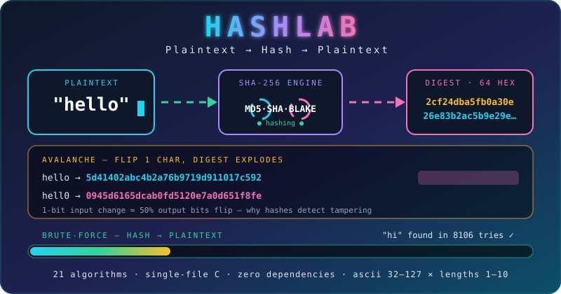

<div align="center">


[](https://github.com/BhavyaDudhatra/Hash-algorithms-using-C-language)



[](./main.c)
[](./docs/ALGORITHMS.md)
[](./docs/ALGORITHMS.md)
[](./docs/ALGORITHMS.md)
[](./docs/ALGORITHMS.md)
[](./docs/ALGORITHMS.md)
[](./LICENSE)

</div>

# Hash Algorithms in C

Single-file C program with two modes:

1. **Plaintext → hash** — hash a string with any of 21 algorithms.
2. **Hash → plaintext** — brute-force a hash back to its plaintext.

## Supported algorithms

| Family | Algorithms |
|:--|:--|
| Legacy | MD5, SHA-1, RIPEMD-160 |
| SHA-2 | SHA-224, SHA-256, SHA-384, SHA-512, SHA-512/224, SHA-512/256 |
| SHA-3 | SHA3-224, SHA3-256, SHA3-384, SHA3-512, SHAKE128, SHAKE256 |
| BLAKE | BLAKE2b, BLAKE2s, BLAKE3 |
| Other | Whirlpool |
| Checksums | CRC32, CRC64 (not secure hashes) |

Full digest sizes + test vectors: [`docs/ALGORITHMS.md`](./docs/ALGORITHMS.md).

## Quickstart

```bash
git clone https://github.com/BhavyaDudhatra/Hash-algorithms-using-C-language.git
cd Hash-algorithms-using-C-language

# Windows (MinGW)
gcc -O2 -o hasher.exe main.c
.\hasher.exe

# Linux / macOS
make linux
./hasher
```

Menu:

```text
1. Plain text to hash
2. Find plain text from hash (brute force)
3. Exit
```

- `1` → type plaintext (max 4095 chars) → pick `1–21` → hex digest.
- `2` → paste hex hash → pick algorithm → brute-forces lengths `1–10`.

## Example

```text
Plain Text : "hello"
SHA-256    : 2cf24dba5fb0a30e26e83b2ac5b9e29e1b161e5c1fa7425e73043362938b9824
```

```text
Hash       : 8f434346648f6b96df89dda901c5176b10a6d83961dd3c1ac88b59b2dc327aa4
Match found: "hi" (SHA-256, 8106 attempts)
```

More outputs for `hello` / `abc` / `HashLab` / empty: [`examples/hashes.md`](./examples/hashes.md).
Full transcript: [`examples/demo_session.txt`](./examples/demo_session.txt).

Avalanche effect (`MD5`):

| Input | Digest |
|:--|:--|
| `hello` | `5d41402abc4b2a76b9719d911017c592` |
| `hell0` | `0945d6165dcab0fd5120e7a0d651f8fe` |

## How cracking works

- Alphabet: printable ASCII `32–127` (96 symbols), lengths `1–10`.
- Search space split into `4096`-candidate chunks, pulled atomically by up to 64 threads.
- Details: [`docs/HOW_IT_WORKS.md`](./docs/HOW_IT_WORKS.md).

> Lengths 1–2 finish in seconds; length 5+ takes hours/days; length 10 is infeasible — that is the lesson. Only crack short strings you created yourself (labs / CTFs).

## Files

| Path | Description |
|:--|:--|
| `main.c` | Entire app, zero dependencies |
| `docs/ALGORITHMS.md` | Algorithm matrix + vectors |
| `docs/HOW_IT_WORKS.md` | Padding, compression, brute-force |
| `examples/` | Real `main.c` outputs |
| `Makefile` / `build.bat` | Linux / Windows builds |

## License

MIT — see [`LICENSE`](./LICENSE).

<div align="center">


</div>
